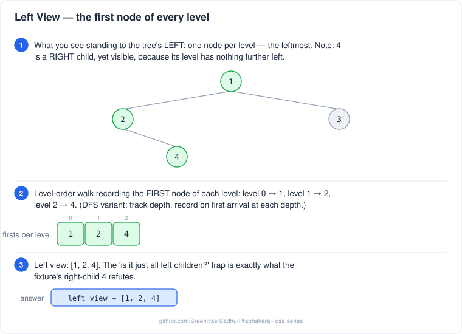

# Left View of a Binary Tree

> Striver SDE Sheet 109 · Day 17 Binary Tree — DFS left-first; whoever reaches a new depth first is visible, and `depth == len(view)` detects exactly that. Go, stdlib only, tested.

## Problem

Standing to the left of a binary tree, which nodes are visible? One per level: the leftmost — which, when the left side is shallow, can live in the *right* subtree, the case that breaks "just follow left children".

## Approach

The BFS answer (first node per level) works; the DFS version is slimmer. Traverse root → left → right carrying the depth: with that ordering, the **first** node ever to arrive at a given depth is the leftmost of its level. "First at this depth" has a tidy encoding — the view list grows one entry per level, so `depth == len(view)` is true exactly once per level. Append there, recurse. Right view is the same function with the child calls swapped — one of those symmetries worth noticing rather than memorizing two algorithms.

**Complexity:** O(n) time, O(h) recursion.

## Visual walkthrough

Read the picture top to bottom — each numbered frame is one moment of the algorithm
running on this repo's test example.

## Run

    go test ./...   # verify
    go run .        # demo

---

One of 191 repos solving Striver's SDE Sheet in Go — stdlib only, one problem per repo, every solution tested. Browse the set: [`dsa-*` repos](https://github.com/Sreenivas-Sadhu-Prabhakara?tab=repositories&q=dsa-&type=source).
